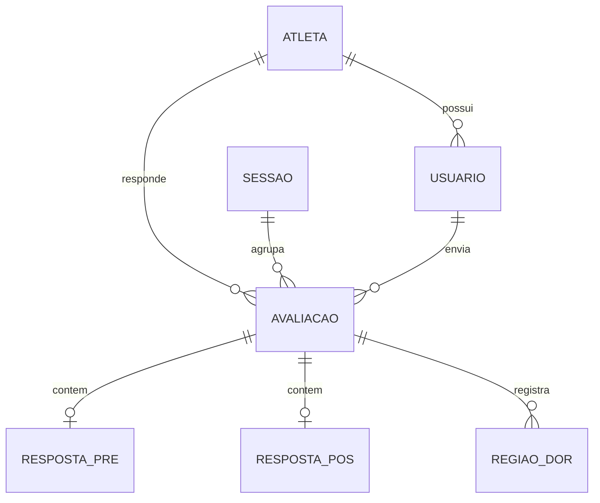

# Modelo de dados implementado

O PostgreSQL armazena contas, atletas, sessões, avaliações e respostas. A API ASP.NET Core acessa o banco por meio do Entity Framework Core e do provedor Npgsql.

## Entidades

### Atleta (`Athlete`)

Guarda o nome e a identificação de cada atleta.

### Usuário (`AppUser`)

Guarda o usuário, hash da senha, perfil e vínculo com um atleta quando o perfil é de atleta. A comissão possui conta própria.

### Sessão de treino (`TrainingSession`)

Guarda data e horário, tipo (treino ou partida) e descrição opcional. No protótipo, a comissão cadastra as sessões e os atletas escolhem uma ao responder. A forma de cadastro ainda pode ser confirmada com o clube e os orientadores.

### Avaliação (`Evaluation`)

Registra o atleta, o usuário que enviou, a sessão, o tipo (pré ou pós) e o horário de envio. A combinação de atleta, sessão e tipo tem índice único, garantindo no máximo uma avaliação pré e uma pós por atleta em cada sessão.

### Resposta pré-treino (`PreTrainingResponse`)

Contém recuperação (1–10), horas de sono (0–24), qualidade do sono (1–7), estresse (1–7), fadiga muscular (1–7), hidratação (1–8) e indicador de ausência de dor.

### Região de dor (`PainRegion`)

Armazena uma linha por região selecionada no mapa corporal: cabeça, pescoço, tronco, membros, mãos e pés. O clube definiu que não é necessário registrar intensidade por região.

### Resposta pós-treino (`PostTrainingResponse`)

Contém percepção de esforço (1–10) e duração do treino (1–600 minutos).

## Relações

Uma avaliação é de um único tipo e contém a resposta pré ou pós correspondente. Uma resposta pré pode registrar nenhuma região (quando a opção “sem dor” está marcada) ou várias regiões.

## Regras dos formulários

As perguntas e escalas permanecem fixas no código desta versão. A API valida os intervalos dos valores recebidos. O esquema PostgreSQL para uma instalação nova está em `database/001_schema_postgresql.sql`.
